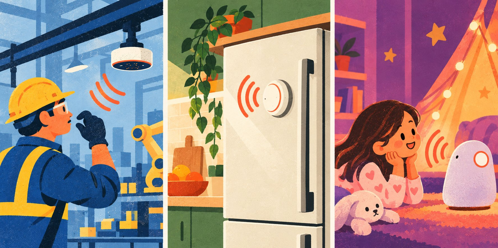
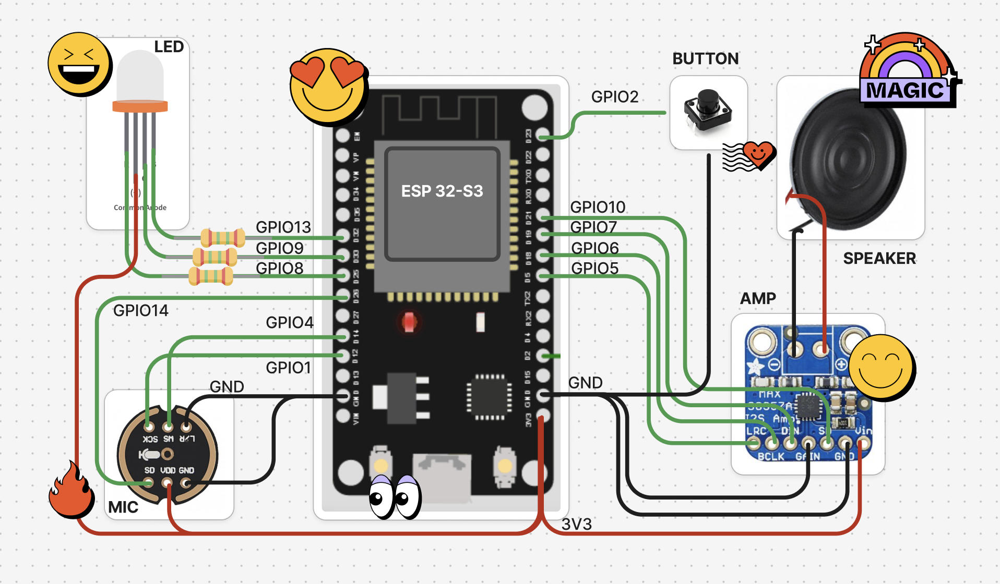

# Running Higgs Realtime on ESP32

The Boson AI Team

October 27, 2026

Developers can now build ESP32 voice devices powered by Higgs Realtime using [Elato’s open-source stack](https://github.com/akdeb/ElatoAI). With a roughly $10 ESP32-S3 board, a microphone and a speaker, the setup brings live speech-to-speech conversation to low-cost, low-power hardware, without external PSRAM.

A kitchen assistant that talks you through a recipe, an equipment interface you can use hands-free, or an educational gadget with choose-your-adventure stories all need the same foundation: a device that can listen, send speech to the model and play the reply. This implementation provides that foundation with Arduino firmware, secure WebSockets and a Deno edge relay.



## A speech-to-speech model for physical devices

[Higgs Realtime](https://docs.boson.ai/overview) accepts live audio and streams spoken responses within a persistent, two-way session. Turn detection, interruption handling and tool use are part of the API, so developers can build conversational behavior around an ongoing session.

The model runs in the cloud. On the device, the work is limited to audio capture, networking, decoding and playback. This keeps the processing and memory requirements small enough for an ESP32-S3 and lets developers configure the voice and instructions on the server.

## The hardware

The reference build uses:

- An ESP32-S3 development board with Wi-Fi
- An INMP441 I2S microphone
- A MAX98357A I2S amplifier and a small speaker
- A button or touch pad to control the conversation
- An RGB LED for status feedback

The microphone and amplifier connect to separate I2S ports for audio input and output. Pin assignments live in the firmware’s `Config.cpp`, so builders can adapt the wiring to their board layout. The firmware uses the Arduino framework and can be built and flashed with PlatformIO.

```cpp
// firmware-arduino/src/Config.cpp
const uint32_t MIC_SAMPLE_RATE = 16000;

// INMP441 microphone on I2S_NUM_1
const int I2S_SCK = 1;
const int I2S_WS  = 4;
const int I2S_SD  = 14;

// MAX98357A amplifier on I2S_NUM_0
const int I2S_BCK_OUT  = 6;
const int I2S_WS_OUT   = 5;
const int I2S_DATA_OUT = 7;
const int I2S_SD_OUT   = 10;

// Button or touch pad; also wakes the device from deep sleep
const gpio_num_t BUTTON_PIN = GPIO_NUM_2;
const int RED_LED_PIN = 9, GREEN_LED_PIN = 8, BLUE_LED_PIN = 13;
```



Deep sleep reduces idle power use between sessions. Battery requirements depend on the application: Wi-Fi, audio processing, speaker volume and time spent in conversation all contribute to active power consumption.

## From microphone to model and back

```text
Microphone → ESP32 → Deno relay → Higgs Realtime
Speaker   ← ESP32 ← Deno relay ← streamed response
```

Higgs Realtime uses an OpenAI-compatible API, so the integration can reuse the same messaging protocol already used for OpenAI Realtime. The ESP32 sends microphone audio over a secure WebSocket to the relay, which forwards it to the API as `input_audio_buffer.append` events. As the model generates a reply, the relay receives `response.output_audio.delta` events, compresses the audio with Opus and streams it back to the board. The firmware decodes each chunk for playback without waiting for the complete answer.

The relay handles the API protocol and keeps the Boson API key off the device. At the start of a session, it sends a `session.update` message with the character’s instructions, voice, audio configuration and turn-detection settings. These can change without reflashing the firmware. The backend also stores transcripts for conversation history.

```typescript
// server/deno/models/boson.ts — session setup excerpt
const BOSON_REALTIME_URL = "wss://api.boson.ai/v1/realtime";
const BOSON_MODEL = Deno.env.get("BOSON_REALTIME_MODEL") || "higgs-realtime";

const bosonWs = new WebSocket(`${BOSON_REALTIME_URL}?model=${BOSON_MODEL}`, {
    headers: { Authorization: `Bearer ${bosonApiKey}` },
});

bosonWs.on("open", () => {
    sendBoson({
        type: "session.update",
        session: {
            type: "realtime",
            model: BOSON_MODEL,
            output_modalities: ["audio"],
            instructions: systemPrompt,
            audio: {
                input: {
                    format: { type: "audio/pcm", rate: SAMPLE_RATE },
                    transcription: { model: BOSON_TRANSCRIPTION_MODEL },
                    turn_detection: {
                        type: "server_vad",
                        threshold: Number(Deno.env.get("BOSON_ESP32_VAD_THRESHOLD") || "0.35"),
                        prefix_padding_ms: 400,
                        silence_duration_ms: Number(Deno.env.get("BOSON_ESP32_VAD_SILENCE_MS") || "700"),
                    },
                },
                output: { format: { type: "audio/pcm", rate: SAMPLE_RATE }, voice },
            },
            tools: sendFunctionTools(),
            temperature: Number(Deno.env.get("BOSON_TEMPERATURE") || "0.3"),
        },
    });
});
```

## Turn-taking and interruptions

Once a session is open, server-side voice activity detection identifies when the user has finished speaking. The adapter defaults to a 700 ms silence window, with a configurable detection threshold. These settings let developers tune the pause before a response for their application.

The relay translates session events into device messages such as `RESPONSE.COMPLETE` and `RESPONSE.INTERRUPTED`, coordinating the conversation with speaker playback. When the device sends an interruption command, the adapter cancels the current response and truncates the conversation to the audio already heard. That prevents an unplayed portion of an answer from remaining in the conversation as though the user had heard it.

```typescript
// server/deno/models/boson.ts — audio and event handling excerpts
bosonWs.on("message", async (data: Buffer) => {
    const event = JSON.parse(data.toString("utf-8"));
    switch (event.type) {
        case "response.output_audio.delta":
            opus.push(Buffer.from(event.delta, "base64")); // PCM in, Opus packets out
            break;
        case "response.done":
            opus.flush(true);
            if (event.response?.status !== "cancelled") {
                ws.send(JSON.stringify({ type: "server", msg: "RESPONSE.COMPLETE" }));
            }
            break;
        case "input_audio_buffer.speech_started":
            ws.send(JSON.stringify({ type: "server", msg: "RESPONSE.INTERRUPTED" }));
            break;
    }
});

// ESP32 → Higgs Realtime: forward microphone audio once connected
clientWs.on("message", (data: RawData, isBinary: boolean) => {
    if (isBinary) {
        const buffer = Buffer.isBuffer(data) ? data : Buffer.from(data as ArrayBuffer);
        sendBoson({
            type: "input_audio_buffer.append",
            audio: buffer.toString("base64"),
        });
    }
});
```

A session can end through a device command or through the model’s `end_call` tool when the user says goodbye.

## Streaming across a global network

Stable speech on a microcontroller depends on the whole audio path. Opus keeps returning audio compact, and continuous streaming lets the board play chunks as they arrive. The Deno relay can be deployed on globally distributed edge infrastructure to serve devices in different regions.

[Elato’s published results](https://github.com/akdeb/ElatoAI#-important-stats) report roughly two to three seconds of round-trip latency globally, with tests of up to 17 minutes of uninterrupted conversation. These are results for the broader stack, rather than a dedicated Higgs Realtime benchmark. Wi-Fi quality, deployment region and model response time affect latency; establishing the first connection adds delay, and the edge host’s runtime limit caps session length.

For a deployment, the practical checks are response time and continuous playback on the networks and in the regions where people will use the device.

## See it in action

[Watch an ESP32 voice device using Higgs Realtime](https://www.youtube.com/watch?v=GZK36IFCv0U).

## Get started

The [Higgs Realtime adapter](https://github.com/akdeb/ElatoAI/blob/main/server/deno/models/boson.ts) is available under `server/deno/models/boson.ts`.

1. Follow the [Elato setup guides](https://github.com/akdeb/ElatoAI) to assemble the hardware and configure the backend, device registration and web app.
2. Create a [Boson API key](https://boson.ai/workspace/api-key) and set `BOSON_API_KEY` on the Deno server.
3. Select Higgs Realtime for your character and configure its voice and instructions.
4. Build and flash the firmware, connect the board to Wi-Fi, and start talking.

The adapter defaults to `higgs-realtime`. You can override the model, transcription model and temperature through server environment variables. The [API documentation](https://docs.boson.ai/overview) covers session events and audio configuration; the repository contains the firmware, wiring and deployment instructions for building your own device.
